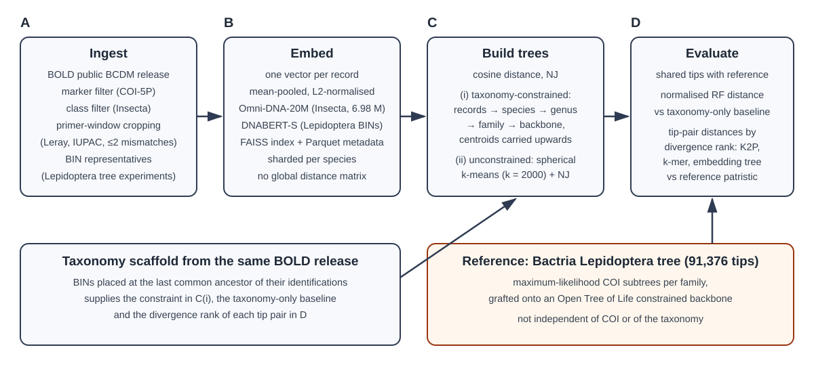

^{1} Independent contributor (affiliation not verified in repository metadata)  
^{2} Microsoft (inferred from commit email domains and project context)  
^{3} Naturalis Biodiversity Center, Leiden, The Netherlands  
\* Senior author and corresponding author.

## Abstract

Environmental DNA metabarcoding has made it practical to observe communities at broad spatial and temporal scales, but many analyses still reduce outcomes to species counts or overlap measures that ignore evolutionary distance. Phylogenetic diversity metrics such as Faith's PD and UniFrac provide richer ecological signal, but they require reference trees whose branch lengths are interpretable and stable across repeated analyses [@faith1992pd; @lozupone2005unifrac; @taberlet2012metabarcoding]. In this preprint we describe EvoSpaice, a repository-centered workflow that builds barcode reference trees by combining taxonomic backbone structure with sequence-embedding distances and local tree refinement.

Our primary design claim is operational rather than algorithmic novelty: the tree should exist outside any one multiplexed metabarcoding run, and should therefore be reusable as an external reference for long-term alpha and beta phylogenetic diversity monitoring. Repository evidence shows that large-scale ingest and embedding runs are feasible for insect COI data from BOLD [@ratnasingham2007bold], and that first-pass validation tooling is in place. However, present analyses also show known weaknesses, including distance saturation at deeper divergences and uncertainty in deep branch-length scaling. We therefore report this work as an evolving method with explicit constraints, not as a finalized phylogenetic reference.

## 1. Why external barcode trees are needed for metabarcoding

The central use case in this project is metabarcoding-based monitoring. In practice, monitoring programs rarely ask only "which taxa are present in one run"; they ask whether ecological communities are changing through time, whether compositional turnover is accelerating, and whether lineage-level diversity is being lost or replaced. Those are inherently comparative questions across many runs, often generated by different batches, primer pools, and local taxon compositions. If each run is interpreted using a run-specific tree, or no tree at all, then phylogenetic diversity trajectories are difficult to compare because the reference frame changes with each run.

An external barcode tree addresses this comparability problem by acting as a durable scaffold. Samples can be interpreted against the same reference structure over time, so changes in alpha PD and beta PD are less confounded by changing internal tree construction choices. This is especially relevant for longer-term biodiversity observatories and multi-site surveillance programs, where continuity and interpretability of metrics may matter more than optimization of any single run. Curation-oriented tasks, including flagging outliers or inconsistent records, remain useful side applications, but they are not the main reason this pipeline exists.

This perspective also influences what "success" means. A useful external tree for monitoring does not need to solve all deep phylogenetic uncertainties in one step, but it must be stable enough to support repeated, comparable PD calculations and transparent enough that uncertainty can be communicated. In other words, reproducibility and explicit limitations are as important as maximizing local fit.

## 2. Position relative to current initiatives

The strategy behind EvoSpaice is aligned with a broader trend: large comparative projects depend on shared phylogenetic frameworks rather than one-off trees. In microbial ecology, this principle is already well established. Greengenes2, SILVA, and GTDB have each shown that standardized references can improve cross-study comparability and support downstream metrics at scale [@mcdonald2024greengenes2; @quast2013silva; @parks2022gtdb]. EvoSpaice is conceptually similar, but targets high-volume DNA barcode data and explicitly adopts a taxonomy-guided approach in which embeddings provide local geometric information.

At deeper taxonomic scales, barcode signal alone is not expected to be sufficient for robust branch-length calibration. For that reason, synthesis resources such as Open Tree of Life and TimeTree are relevant complements rather than competitors in this context [@hinchliff2015opentree; @kumar2022timetree]. Open Tree can provide externally curated higher-level topology, while TimeTree can contribute time-calibrated constraints for deeper divergences. The practical implication is that a future mature pipeline will likely be hybrid: barcode-heavy where shallow signal is strong, and externally anchored where deep signal is weak.

## 3. Aims of this project

The repository's declared scope is intentionally constrained: an insect-focused COI reference-tree workflow that can run at large scale while remaining transparent and inspectable. The scientific aim is to generate branch-length-bearing trees that are useful for phylogenetic diversity calculations, while the engineering aim is to do so without constructing infeasible global all-by-all distance matrices. To achieve this, the workflow uses taxonomy as global scaffold structure and applies embedding distances in localized reconstruction and scaling steps.

A second aim is diagnostic: to determine where embedding distances are trustworthy as phylogenetic distances and where they begin to fail. This includes not only topology comparisons but also behavior of branch lengths across depth strata. A third aim is openness and reproducibility. The project keeps scripts, operational reports, intermediate checks, and validation artifacts in one public repository so that claims can be traced to concrete files rather than narrative summary alone.

## 4. Pipeline overview

The implemented architecture has three linked phases. First, sequence records are ingested and filtered, with marker-window handling and taxonomic constraints applied at data-entry time. Second, retained records are embedded and stored in indexing formats suitable for scalable downstream operations. Third, tree refinement and branch-length assignment proceed in a bottom-up traversal that performs local Neighbor-Joining within taxonomic contexts and applies branch-scaling logic related to the bottom-up assignment framework of Wei and Koslicki [@wei2024branchlengths].

A key architectural property is separation between reference construction and sample analysis. The reference-building phase is executed per source release and produces durable artifacts that can later be reused for many independent metabarcoding analyses. This is deliberate: it reduces redundant compute, supports methodological consistency across projects, and makes it easier to interpret year-over-year PD shifts because the background tree is not rebuilt ad hoc for every run.

Another practical property is locality of distance computation. Instead of materializing a global pairwise matrix, the workflow computes distances on demand within localized reconstruction contexts. This keeps memory and runtime demands tractable while preserving the ability to inspect where each inferential decision is made.

## 5. Experiments and implementation status so far

The repository currently provides evidence for both pipeline execution and methodological diagnostics. Operationally, the class-filter and embedding workflow has been run at substantial scale on an insect-focused BOLD-derived input. The recorded production report documents 6,979,067 retained and embedded records, generation of corresponding FAISS and Parquet artifacts, and downstream species-sharded outputs across 131,914 species bundles. This does not by itself validate phylogenetic quality, but it does establish that the core dataflow is executable at the intended order of magnitude.

The project also includes reconciliation checks that are essential for trust in large-scale processing: manifest consistency, ID-range consistency, and shard-level completion checks. These are important because subtle ID drift or partial output can invalidate biological interpretations even when headline runtimes look successful. In this repository, these checks are explicitly documented in operational reports and not only in code comments.

For tree-level handling, overlap and pruning reports provide visibility into how much taxon intersection is retained in comparative analyses. For example, one overlap report retains 61,381 shared tips from larger source trees, with explicit accounting of dropped tips on both sides. A Papilio-focused subset workflow is also documented as a targeted test case. These results are not final scientific outputs, but they show that the comparison plumbing and subset extraction stages are functioning on nontrivial data slices.

Validation instrumentation for inferred-versus-reference trees is further developed than in many exploratory repositories. The included validation tools report normalized Robinson-Foulds topology differences and tip-to-root depth correlations, and the transcripted demo reports a case with normalized RF of 23% and tip-depth correlation of 0.7 for one comparison. These are context-specific metrics and should not be over-generalized, but they demonstrate that the project can quantify similarity in interpretable ways.

Finally, stratified distance diagnostics are present in reusable scripts and example outputs. Running the provided diagnostics script on `pairs_strat.tsv` yields Pearson correlation 0.452 and Spearman correlation 0.602 between patristic and sequence distances, with high-patristic bins showing little additional sequence-distance increase. This pattern is central to the current interpretation: the approach is informative at shallow to moderate depth, but presently under-constrained for deeper branch-length calibration.

Taken together, the evidence supports a cautious feasibility claim. The repository demonstrates that the workflow can run and produce inspectable outputs at scale, while also documenting where current biological interpretation remains uncertain.

## 6. Known limitations and failure modes

The most important present limitation is depth-dependent saturation in barcode-derived distance behavior. In the current COI stratified checks, sequence-distance medians increase with patristic distance in shallower bins and then flatten at larger patristic ranges. In practical terms, this implies that genuinely deep divergences can map to compressed distance values, which then weakens contrast among deep branches. For PD applications this matters directly, because compressed deep branches reduce sensitivity to broad lineage turnover.

A second limitation is model mismatch between distance geometry and branch-length assignment assumptions. Bottom-up branch-length assignment works best when input distances are sufficiently tree-additive. Embedding distances optimized for retrieval may be monotonic but not additively calibrated across all depths. When this occurs, branch assignment can exhibit symptoms such as negative-length pressure (followed by clamping) or smoothing artifacts in internal branches.

Third, local Neighbor-Joining can produce precise-looking binary structure even when the deep signal is weak. Because the algorithm resolves by construction, users can over-interpret high-resolution internal structure unless confidence gating is applied. This is not an implementation bug; it is an inference-risk characteristic that must be handled explicitly in downstream interpretation.

Fourth, present outcomes are release- and configuration-dependent. The repository is transparent about this: several validation outputs are explicitly labeled as tied to particular seeds, source snapshots, and parameter choices. That transparency is valuable, but it also means current numbers should be read as evidence from specific runs, not as globally stable performance estimates.

Fifth, taxonomic incompleteness remains substantial in high-volume barcode data. In the documented production run, unknown-species routing remains large, which limits how confidently deep branches can be interpreted when many records are only weakly resolved taxonomically.

These limitations are not peripheral. They affect the quantity being estimated and therefore how PD values should be interpreted. If deep branches are compressed or uncertain, alpha PD may be underestimated in phylogenetically broad assemblages, and beta PD can become relatively more sensitive to shallow turnover than to deeper lineage replacement.

## 7. Future work

The immediate next step is to formalize a hybrid depth strategy rather than force one distance model to serve all scales. Barcode-informed distances should remain primary for shallow and intermediate regions where empirical checks indicate useful signal. At deeper levels, topology should be constrained by external synthesis resources such as Open Tree of Life, and branch-length scaling should be informed by age-calibration resources such as TimeTree [@hinchliff2015opentree; @kumar2022timetree]. This would make explicit what current evidence already suggests: deeper structure should not depend on barcode distances alone.

Methodologically, this implies depth-aware confidence annotations and potentially depth-aware objective functions during branch assignment. Operationally, it implies versioned releases of reference trees with clear metadata about which branches are barcode-driven and which are externally anchored. Scientifically, it implies that PD estimates can be reported with clearer uncertainty language rather than as single-point values detached from branch-confidence context.

Additional work is also needed on benchmarking design. Future experiments should include repeated runs across source releases, controlled perturbation studies for sensitivity to filtering and representative selection, and explicit comparisons between embedding-based and k-mer-based distance regimes under the same reconstruction protocol. These are necessary to move from proof-of-feasibility toward robust methodological guidance.

## 8. Generative AI use disclosure

Generative AI has been used in this project in both engineering and writing workflows. In software development, the team used an AI-assisted "hypervelocity engineering" approach in which model-assisted coding accelerated implementation, refactoring, and documentation tasks. In manuscript preparation, AI assistance was used for drafting and restructuring text from repository artifacts and explicit author instructions.

This disclosure is intended to be specific rather than symbolic. AI tools can increase throughput and coverage, especially in prototype phases, but they also increase the risk of plausible but incorrect statements and over-smoothed narratives. For that reason, this manuscript should be evaluated against the cited literature and the concrete repository artifacts it references. Claims not grounded in those sources should be treated as hypotheses pending verification.

## 9. Data, code, supplements, and licensing

All supplementary materials for the research activity described here are available in this repository (`naturalis/evospaice`), including pipeline scripts, architecture and operations documentation, test fixtures, and validation outputs. This is intentional: the repository serves as both implementation substrate and supplement archive so that methods and claims can be independently inspected.

As documented in the project README, outputs of the main workflow are released as public-domain outputs (CC0 1.0). The manuscript should therefore be interpreted as an open progress report on an ongoing method-development effort. The current evidence supports feasibility and highlights important limitations; it does not yet justify claims of a fully resolved, deeply calibrated, production-grade global barcode phylogeny.

# References
